# GreenGetaway: a sustainable guide to Copenhagen, redesigned

Tags: React Native, Expo, UI Re-design, Accessibility, Front-end, Mobile

## Overview

GreenGetaway is a mobile app for finding the greenest things to do in Copenhagen. It puts 13 attractions on a map with an eco score from 0 to 100, ranks them, and lets you log the places you visit with a date and a photo.

The app began in 2023 as a group project for the course Programming Mobile Applications at the IT University of Copenhagen, built with React Native and Expo. My part of that project was the eco score list and the Leaderboard.

In 2026 I came back to it on my own. I audited the 2023 app, redesigned all five screens and the sign-in, and built a browser version so both versions can be tried side by side from this portfolio. The audit, the redesign and the web build are my work alone.

The brief I set myself was a refresh of the same product, not a rebrand: the same five tabs, the same 13 attractions and the same scores, so the comparison is fair. What changed is how the app explains and records things.

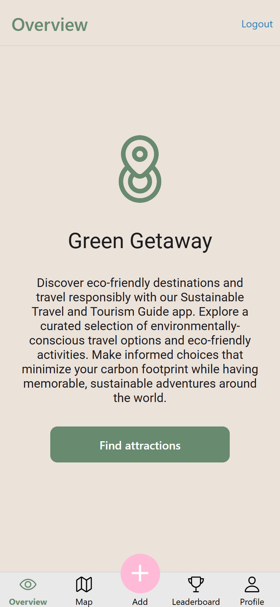 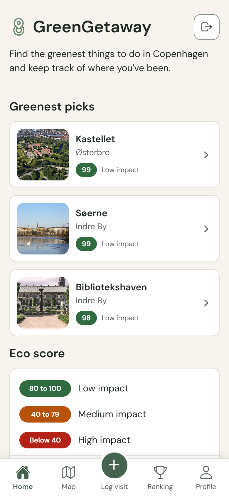

## Problem

The 2023 app worked, but it did not hold together as a product. The audit found eight problems.

1. **Contrast failed across the brand colours.** Measured against WCAG 2.2: brand green on the beige background was 3.01:1, used for headers and labels. White on the green buttons was 3.85:1. The pink Add button with a white icon was 1.58:1. The 99% eco score on the detail card was 2.26:1, so the most important number on the screen was the hardest to read.
2. **The first screen said nothing.** Overview was a paragraph of generic copy that promised "adventures around the world" in a Copenhagen-only app, with one button that repeated the Map tab.
3. **The eco score was never explained.** Pins were green, yellow or red with no legend, so their meaning relied on colour alone, in the exact red and green pair that colour-blind users confuse.
4. **The Leaderboard showed nine of 13 places.** It listed only the green attractions under the heading "the most green activities", so the four low scorers disappeared. Every row carried the same vague "See details" link, nine times over. This was my part of the 2023 project, so this is me reviewing my own work.
5. **Logging a visit did not record a visit.** There was no save step. The attraction was free text, so it could not link to the attraction data and a typo created a new place. The date was one shared value, so each new entry overwrote the last. The photo went into a separate list with no link to any visit.
6. **The detail card ended in "Go back".** It showed the name, score, address and two photos, then nothing to do next: no directions, and no way to log a visit from the place you were looking at.
7. **The chrome was noisy.** Every header repeated the tab name next to a blue Logout link (3.29:1, and outside the palette), so a session-ending action sat on every screen. The inputs were lilac, also off-palette. The empty Profile read "You haven't taken any photos yet :(".
8. **The data was copied three times.** The attractions lived in the map, the web map and the Leaderboard, and the copies had already drifted: "Amager Fælled" against "Amager Fællede", "Frederiks Kirke (Marmorkirken)" against "Frederiks Kirke", and two different photos for Søerne.

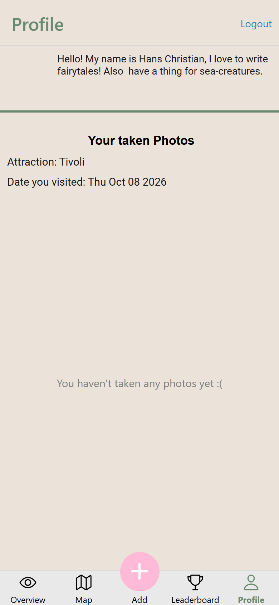 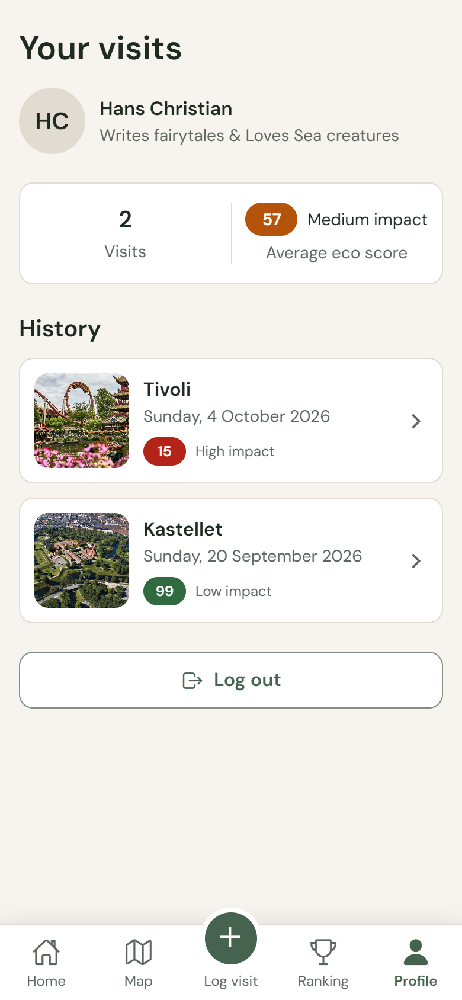

*Two visits logged in each version. In 2023 the second entry, Tivoli, replaced the first. In 2026 both are kept.*

## Outcomes

- Every text and colour pair now passes WCAG 2.2. An automated scan of 153 visible text elements across nine screens and sheets found no failures. The lowest ratio in the app's own interface is 5.02:1, up from 1.58:1 for the 2023 Add button.
- The eco score is always shown as colour, number and label together, and the first screen explains it before the map.
- The ranking shows all 13 places, up from nine, with one tap target per row and no repeated "See details" links (nine in 2023).
- A visit is one saved record. Entries no longer overwrite each other, and the photo belongs to the visit it was taken for.
- The attraction detail answers the next question: how do I get there, and can I save that I went.
- One data source replaces three copies, so screens can no longer disagree.
- Map pins, sheets and the version toggle work with the keyboard, and focus returns to where it was when a sheet closes.

## Approach

Each change follows the same pattern: the problem the audit found, what changed, and why that made the experience better.

### One source of attraction data

**Problem:** three copies of the same 13 attractions, already disagreeing on names and photos.
**Change:** one module holds every attraction with its name, area, score, band, address, coordinates, photos and pin colour. The band is calculated from the score, never typed by hand. Names settled on one spelling each, with scores, coordinates and addresses checked by script against the 2023 data.
**Why:** the screens can no longer disagree, and the rules for the eco score live in one place.

### Eco score bands with a legend

**Problem:** colour-only pins in red and green, and no explanation of what a score means.
**Change:** three bands, each shown as colour, label and number: 80 to 100 is low impact, 40 to 79 medium, below 40 high. A legend sits on Home and on the map, with a "How eco score works" sheet. The sheet says plainly that every score is an approximation, worked out in 2023 from available data and logical reasoning: free outdoor places score highest, and the zoo, the museum, Tivoli and Den Blå Planet were scored from published sources on emissions from animals, feed, water and electricity.
**Why:** people can read the map before tapping anything, colour-blind users get the same information, and the scoring is honest about how it was made.

### Pins that show the score

**Problem:** green, yellow and red pin images that said nothing on their own.
**Change:** each pin is a badge in its band colour with the score in white. Where pins overlap in the city centre, red sits above amber above green, and within a band the higher score sits on top. That second rule came from verification: at first, The Little Mermaid's pin completely covered Kastellet, the highest-scoring place, so it could not be tapped.
**Why:** the map becomes scannable, the numbers survive colour blindness, and both the places to avoid and the best place in a cluster stay visible.

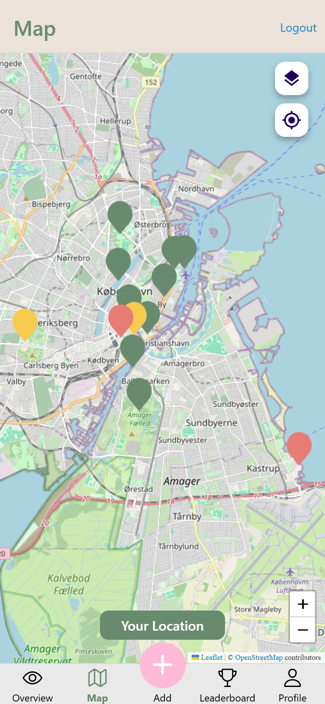 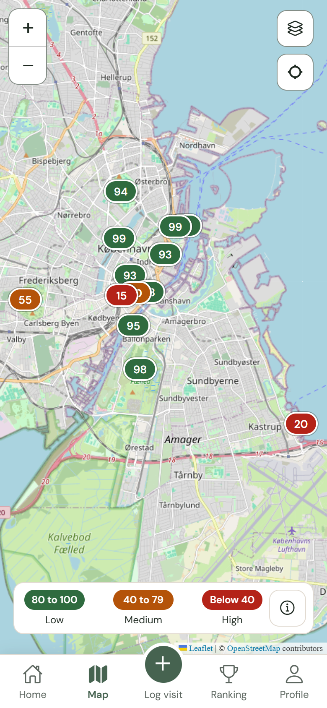

### A detail sheet that leads somewhere

**Problem:** a card that ended in "Go back".
**Change:** a bottom sheet with a photo (falling back to the second photo, then a neutral placeholder, when a third-party image fails), the name and area, the score with its band, the address, "Get directions" to Google Maps, and "Log a visit here", which opens the form with the attraction already chosen. It closes with an X, a tap outside, or Escape, and keyboard focus returns to the pin.
**Why:** the sheet answers the next question instead of ending the journey.

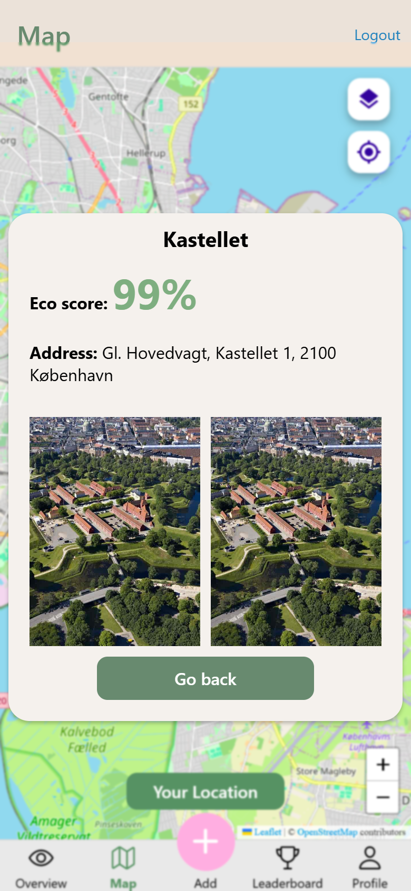 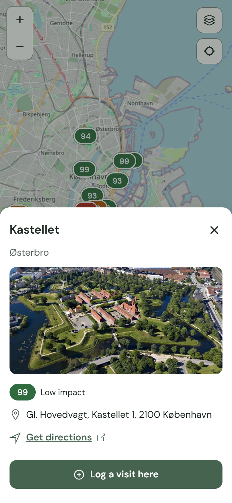

### Overview becomes Home

**Problem:** generic copy and a button that repeated the Map tab.
**Change:** one Copenhagen-specific line, the three greenest places, the score legend, and a shortcut to log a visit. The greenest picks started as a sideways row, but testing in a desktop browser showed that a mouse cannot drag-scroll it, so the third pick was out of reach. They are now stacked rows.
**Why:** the first screen shows real places and teaches the scoring before the map.

### The Leaderboard becomes a ranked list

**Problem:** nine of 13 places and nine identical links.
**Change:** all 13 places ranked by score and grouped by band, with a pinned header for each band. Each row is one tap target with rank, photo, name, area and score, and opens the same detail sheet. Equal scores share a rank. The tab reads "Ranking".
**Why:** one large target per row, an honest ranking, and the low scorers stay visible, because knowing what to avoid is useful too.

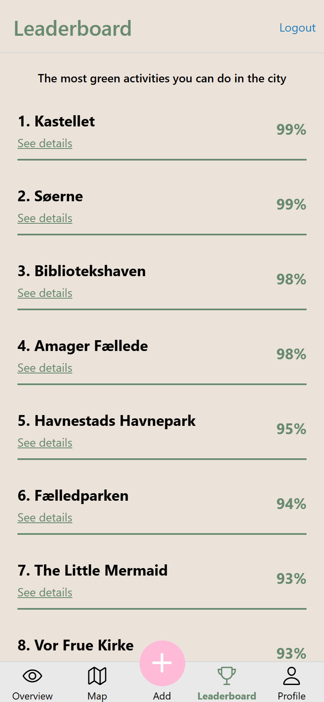 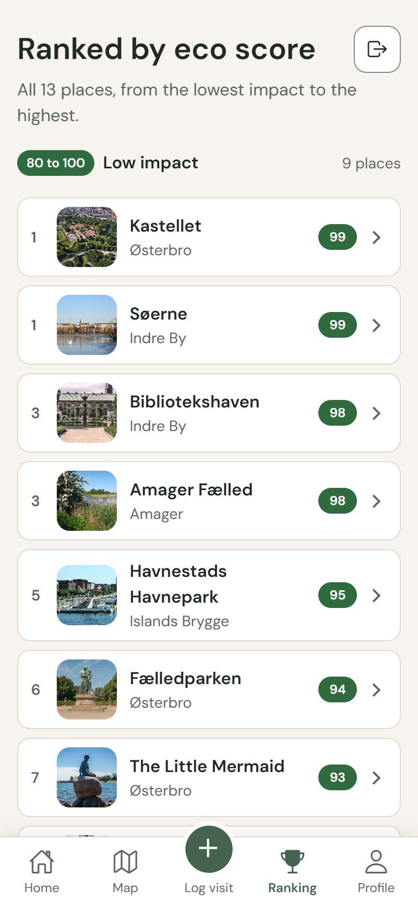

### Add becomes "Log a visit"

**Problem:** no save step, free text, one shared date, and photos with no home.
**Change:** the attraction is chosen from the 13 with search, which also works without Danish letters ("faelled" finds Amager Fælled). The date defaults to today and is written out in full, because the browser's own date format is ambiguous between British and American readers. The photo is optional and attaches to the visit. "Save visit" stays disabled until an attraction is chosen, with a line saying why, and saving confirms and opens Profile.
**Why:** a visit becomes one coherent record, entries stop overwriting each other, and you know when something has been saved.

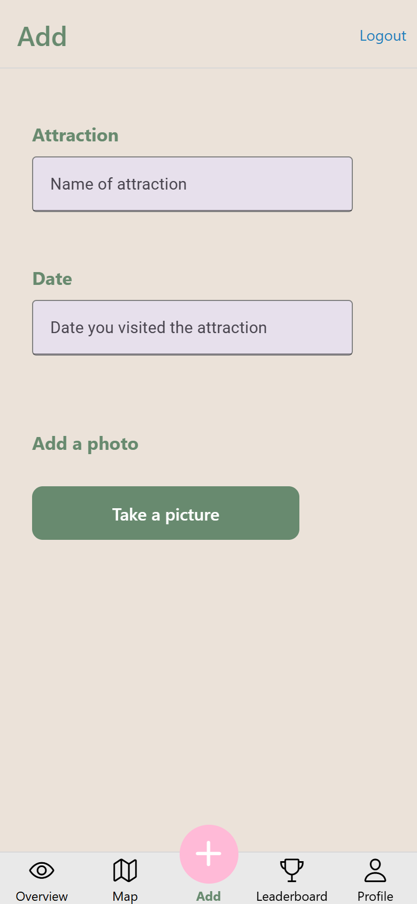 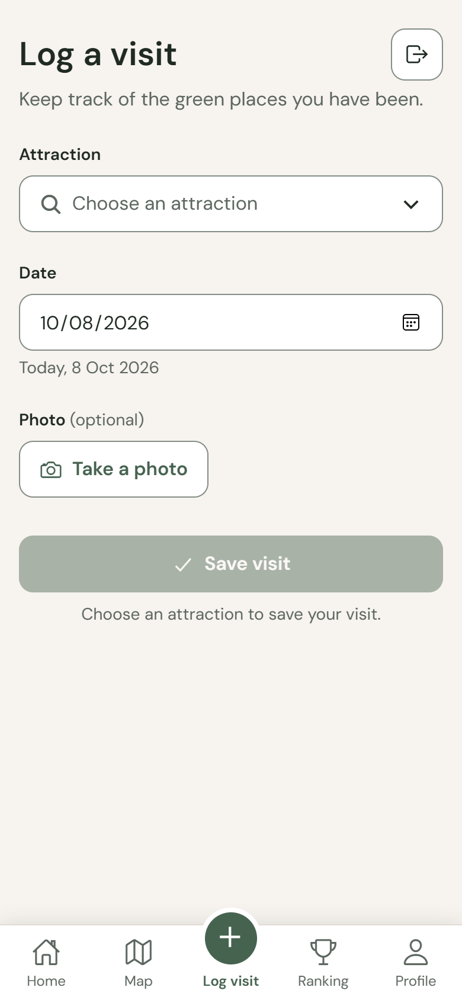

### Profile becomes "Your visits"

**Problem:** one overwritten entry, a loose photo grid, and a sad-face empty state.
**Change:** a summary of how many visits and the average eco score, with its band written out. The history shows each visit with photo, attraction, date and score, newest first. The empty state reads "No visits yet" with a "Log your first visit" button.
**Why:** progress is visible, and the average is honest: a visit to Tivoli pulls it down.

### Calmer chrome and sign-in

**Problem:** headers that repeated the tab name, a blue Logout link on every screen, an off-palette pink button, and placeholders that gave instructions.
**Change:** each screen carries its own title. Logout became a clear outlined button on Profile and, after review, a quiet 44 point icon in the title row of Home, Ranking and Log visit, so leaving does not mean a trip to Profile. The centre button is the primary green with a white plus (6.6:1). Tab labels pass 4.5:1, and every touch target is at least 44 by 44. One typeface, DM Sans, in two weights per screen. Sign-in has visible labels, "name@example.com" as the only placeholder, a full-width "Log in", and errors written in plain language. On the web demo, a note says any email and password work.
**Why:** the interface gets out of the way, and the session-ending action is available without shouting.

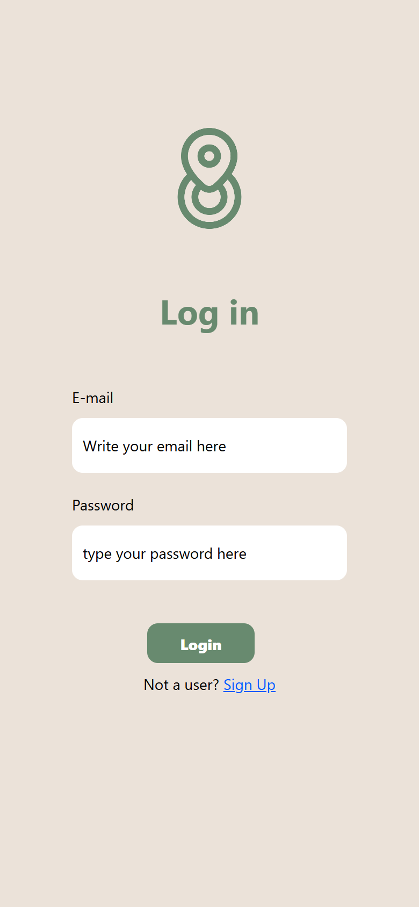 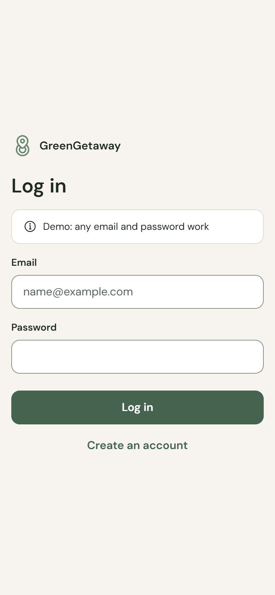

## Methods

- **Audit.** I read the 2023 code screen by screen and measured every text and colour pair against WCAG 2.2, recording the ratios above. I also checked the brief against the code and corrected it where it was wrong. For example, the header Logout colour was #2182BD, not the #005BFF I had first noted, and the 2023 web detail card did show photos.
- **Design tokens.** One file holds every colour, spacing step, radius, type size and shadow, each colour contrast-checked. It keeps the beige-and-green identity, with a darker green for text and buttons, and keeps the original green for the logo only.
- **A frozen baseline.** The 2023 browser build is kept unchanged at `/2023/` and checked by script against the tagged original. The one exception is the map tiles: CARTO began requiring an API key in 2026, which left the 2023 map blank for reasons unrelated to its design, so its two tile URLs were swapped for keyless ones, and the script proves nothing else changed.
- **Screen by screen, with before and after.** Each screen was redesigned, reviewed against a 390 by 844 screenshot of both versions, and only then committed, with each commit message written as problem, change and why.
- **Automated verification.** Scripts in a headless browser ran the full journey in both versions (log in, map, pin, detail, log a visit with a photo, profile, ranking), scanned every visible text element for contrast, and tested the keyboard paths. The checks found two real problems that were fixed: the hidden third pick, and Kastellet's pin buried under The Little Mermaid.
- **Two reviews before release.** A review against Vercel's React best-practices rules cut the JavaScript bundle by 18 percent and fixed a 2023 listener leak that grew every five seconds on a phone. A second review against the UI/UX Pro Max guidelines cut the photos on the ranking from 6.8 MB to 1.86 MB, kept the attraction search clear of the phone keyboard, added hover feedback for mouse users, and kept text to a readable line length in a desktop window.
- **Comparison.** A compare page shows both apps in one phone frame. A 2023 and 2026 toggle sweeps between them like a windscreen wiper over 1.6 seconds, switches instantly for people who prefer reduced motion, and works with the keyboard and screen readers.
- **Limits.** The browser build runs in demo mode without Firebase. The native app builds for iOS and Android, but it has not yet been tested on a device.
